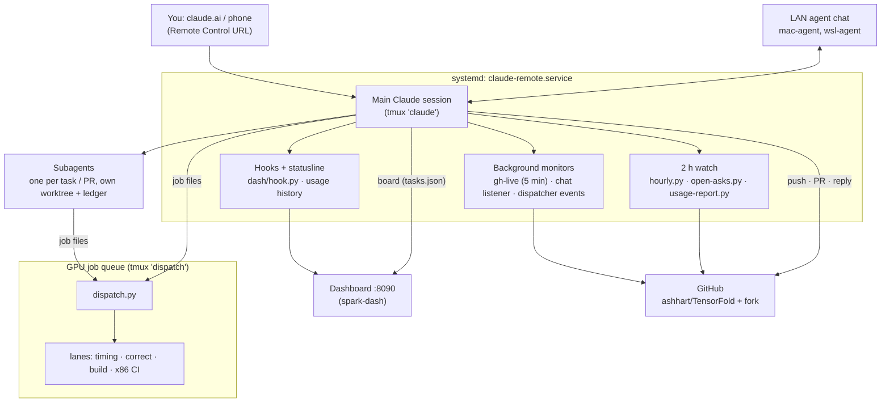

# tf-agent-setup

The "resident TensorFold agent" on a DGX Spark (GB10, aarch64 Ubuntu): one Claude Code session that runs 24/7 under
systemd, contributes to [TensorFold](https://github.com/ashhart/TensorFold), and coordinates helper agents, a GPU job
queue, a dashboard and a LAN agent chat. This repo packages the pieces and the house rules that grew around them.

It is a snapshot of a working setup, not an installer. Paths assume user `jschmied` with notes under `~/notes`;
adjust them for another box.

## Architecture

Not shown: `gpu-clock-cap.service` caps the GPU clock at 2300 MHz at boot so benchmark numbers stay comparable.

## The daily loop

| What | How often | Tool | Doc |
|---|---|---|---|
| GitHub events | every 5 min, one event wakes the session | `watch/gh-live.py --once` | [GITHUB-WATCH](docs/GITHUB-WATCH.md) |
| Full watch | every 2 h | `watch/hourly.py` (PR comments, reviews, mentions, chat, disk, mem, worktrees, usage, OPEN-ASKS) | [GITHUB-WATCH](docs/GITHUB-WATCH.md) |
| Open asks | each watch, each reply | `watch/open-asks.py` (must be 0 or owned) | [GITHUB-WATCH](docs/GITHUB-WATCH.md) |
| Agent chat | 10 s poll | `chat/listen.py spark-agent --room agents` | `memory/local-agent-chat-lxc108.md` |
| GPU / build jobs | event driven | `dispatcher/dispatch.py`, `dispatcher/README.md` | [PIPELINES](docs/PIPELINES.md) |
| Board | on every agent/PR event | `skills/spark-board`, `dash/check.py` | [PIPELINES](docs/PIPELINES.md) |
| PRs | per task | `skills/tf-pr`, `watch/pr-ready.py` | [PIPELINES](docs/PIPELINES.md) |
| Usage budget | before fan-out, each watch | `claude/usage-report.py --json` | `skills/usage-self-management` |

Order of priority: replies to reviewers first (`memory/pr-replies-first.md`), then running work, then new work.

## Layout

| Dir | Contents |
|---|---|
| `docs/` | [SERVICE.md](docs/SERVICE.md) (install, reboot, security), [GITHUB-WATCH.md](docs/GITHUB-WATCH.md), [PIPELINES.md](docs/PIPELINES.md) |
| `systemd/` | `claude-remote.service`, `gpu-clock-cap.service` (installed); `tf-dispatch.service`, `spark-dash.service` (proposals) |
| `bin/` | `claude-remote-start`, `claude-remote-run` (the service wrapper), `tfb` (build-slot wrapper) |
| `dispatcher/` | `dispatch.py`, agent rules `README.md`, `AFTER-REBOOT.md` |
| `watch/` | `gh-live.py`, `hourly.py`, `open-asks.py`, `pr-ready.py` |
| `dash/` | dashboard server, page, board check, Claude hook, `tasks.example.json` |
| `chat/` | `listen.py` (LAN agent chat listener) |
| `claude/` | `settings.excerpt.json` + [README](claude/README.md) (hooks explained), status line, usage report |
| `agents/` | `BRIEF-COMMON.md`, the common rules pasted into every helper agent's brief |
| `skills/` | Claude Code skills used by the loop (copied whole) |
| `memory/` | auto-memory files with the workflow and house rules, [index](memory/README.md) |

## Placeholders

LAN addresses and host names are replaced. Fill them in for your network:

| Placeholder | Meaning | Used in |
|---|---|---|
| `<spark-host>` | the GB10 itself (dashboard :8090) | skills, memory |
| `<chat-host>` | local-agent-chat server (LXC), port 3006 | `chat/listen.py` (or env `AGENT_CHAT_URL`), `watch/hourly.py`, memory |
| `<pbs-host>` | Proxmox backup / archive host (model storage) | `skills/pbs-backup`, `skills/model-archive`, memory |
| `<x86-host>` | x86 box for host-only CI checks (user `tfci`) | `dispatcher/dispatch.py`, `dispatcher/README.md` |
| `<pve-host>`, `<pve-host-name>` | Proxmox VE host running the chat LXC | memory |
| `<lan-subnet>` | LAN /24 allowed to reach the dashboard | memory, `systemd/spark-dash.service` |
| `<agents-room-id>` | chat room id of `agents` | memory |
| `<REDACTED>` | removed secret material | see the local SECURITY-SCAN.md |

Paths under `/home/jschmied` are kept where they are illustrative (unit files, scripts).

## Not included

Secrets (sudo askpass, GitHub/HF tokens, chat admin key, `~/.claude.json`), the live board data (`tasks.json`,
`agents.json`), job queue contents, ledgers, model-experiment memories, the `yukon-cli` and `synced/` skills, and
the `.bak*` copies of scripts.
